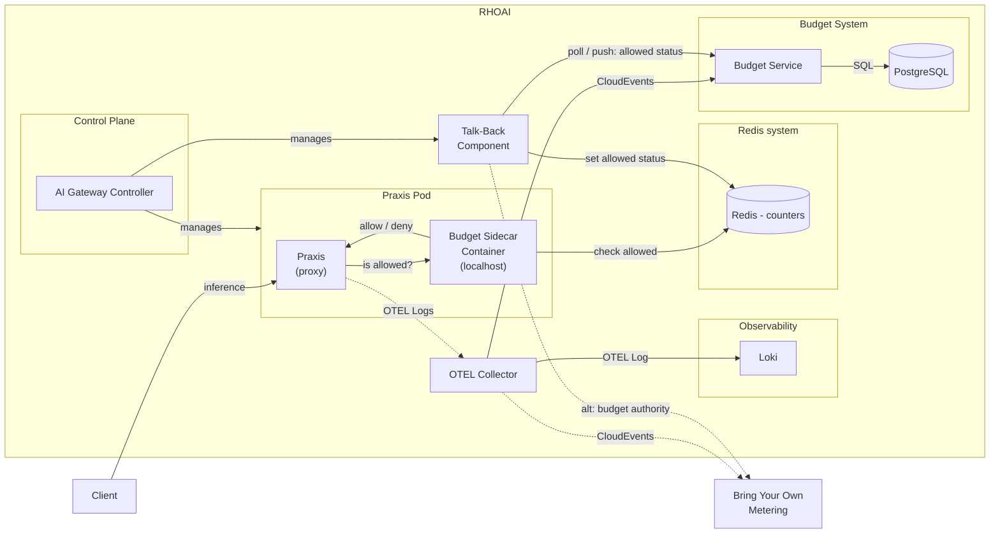
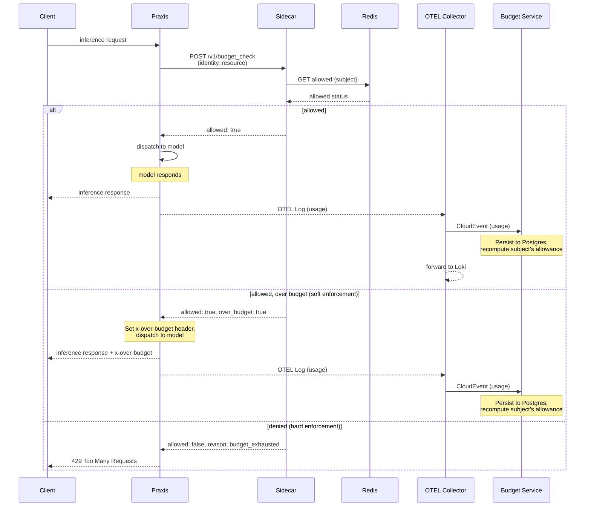
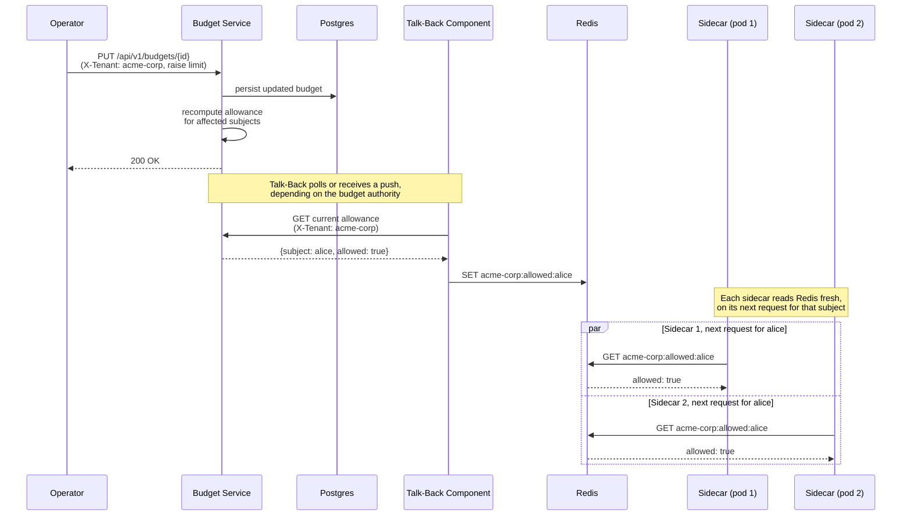

# Open Data Hub - AI Gateway Tokenomics and Budget Service

<!-- copy and paste this template to start authoring your own ADR -->
<!-- for the Status of new ADRs, please use Approved, since it will be approved by the time it is merged -->
<!-- remove this comment block too -->

|                |            |
| -------------- | ---------- |
| Date           | insert date |
| Scope          | |
| Status         | Approved |
| Authors        | Marius Danciu |
| Supersedes     | N/A |
| Superseded by: | N/A |
| Tickets        | |
| Other docs:    | none |

## What

This document proposes a new usage metering solution that is part of the RHOAI product. It allows customers to configure and manage costs and attribution and also visualize usage in the UI dashboards.

## Why

Usage metering and budget enforcement is a major feature of AI Gateway and a very frequent topic raised by customers.

## Goals

* Define the architecture for the Budget Service
* Define the Budget Service APIs
* Define end-to-end flows
* Define the high-level integration with third-party solutions like M360 or OpenMeter, but the actual integration details may be subject to different ADRs in later phases
* This is meant to be a usage metering solution as part of MaaS that works out of the box without bringing in new dependencies (such as Kafka) that customers need to install and manage. Customers don't need to perform extra installation steps in order to have usage metering and budget quota enforcement enabled.
* Budget quota enforcement is intentionally kept as a separate concept from rate limiting. Rate limiting is a QoS topic that for now remains managed in MaaSSubscription at control plane level and applied by Praxis at data plane level.
* Budget cost is abstracted away and referred to in this document as Budget Units (BU).

## Non-Goals

* This is not a billing service. We do not intend to manage aspects like:
    * multi currency
    * invoices
    * billing cycles
    * auditability and disputes
* This is not a generic competing solution for M360 or OpenMeter
* Usage for other resource types apart from tokens, e.g., GPUs. However, the design is flexible so we can address other types of resources in the future.
* The Budget Service storage does not represent the SoR for usage metering. The document will address this separation in the next sections.
* Pacing (spend-rate policies such as daily sub-limits derived from a monthly budget). The architecture supports it in the sidecar without changes to Praxis or the object model, but it is out of scope for the initial implementation.
* Multiple tenants per gateway. The initial implementation supports one tenant per gateway. Multi-tenant gateways may be considered in later releases.
* Distributed tokenomics across multiple clusters. This ADR assumes a single-cluster deployment. Federated budget enforcement, cross-cluster balance synchronization, and multi-cluster usage aggregation are not addressed.

## How


### Architecture



Notes:
- In the Praxis POD, AIGC also brings in the BSC (Budget Sidecar Container)
- Praxis filter remains a PEP (Policy Enforcement Point). All budget calculations happen in the Budget Service — the sidecar and Redis only carry the precomputed allow/deny decision
- Redis/Valkey holds nothing but a per-subject "is this subject allowed to make further inference calls" flag (see [Talk-Back Component](#talk-back-component)). It holds no rates, budgets, policies, or balances — the sidecar has no knowledge of those at all. The Talk-Back Component is the sole writer; it is the only thing that talks to the Budget Service (an external system, outside RHOAI).
- AIGC manages the Praxis Pod and the Talk-Back Component, but not the Budget System — the Budget System is an external system (self-contained by default, or a third-party metering platform), not something RHOAI provisions or owns.
- The OTEL Collector and the Talk-Back Component are both cluster-wide RHOAI services — unlike the sidecar, neither is per-gateway or per-Praxis-pod. Both, along with the Control Plane, the Praxis Pod, Observability, and Redis, are part of RHOAI; only the Budget System (Budget Service, Postgres) sits outside RHOAI, and it can be swapped for a third-party metering platform without RHOAI itself changing.
- The Talk-Back Component is a standalone service, deployed outside the Budget System, that keeps the sidecar's view in Redis — a simple per-subject allow/deny flag — up to date. It retrieves the current allowance decision from whichever system is the budget authority — the Budget Service by default, or an external metering platform when one is configured (see [Bring Your Own Metering](#bring-your-own-metering)) — and writes the result into Redis. This is what makes the Budget Service itself replaceable: the sidecar and Praxis only ever read/write Redis and never need to know which system is authoritative. See [Talk-Back Component](#talk-back-component) for details.
- To limit the number of dependencies, this proposal does not assume the existence of a pub/sub system such as Kafka. However, adding one later can be considered as a mechanism to control back pressure and provide ordering for deduplication. The OTEL Collector could also be a candidate for deduplication, but this ADR does not prescribe an OTEL Collector design. We assume that an existing OTEL Collector is used and that it is at least capable of receiving the usage events and propagating them to the SoR as OTEL logs, to the Budget Service as CloudEvents, and — when a third-party metering system is configured — directly to that system as well. Usage-event distribution is unaffected by the Talk-Back Component — the OTEL Collector always delivers CloudEvents to the Budget Service regardless of which system is the budget authority.
- The OTEL Collector can fan out usage events to an external metering system directly, independently of the Budget Service, by adding a second exporter to its existing pipeline (see [Bring Your Own Metering](#bring-your-own-metering)). This does not require any change to the Budget Service, Praxis, or the sidecar.

#### Inference Flow (budget check)



The sidecar performs a single Redis read per request and nothing else — it holds no rates, budgets, or policies, and never writes to Redis. Whatever changes the subject's allowance as a result of this request's usage happens entirely downstream, at the Budget Service, and reaches Redis later via the Talk-Back Component (see [Talk-Back Component](#talk-back-component)). This means the `allowed` flag the sidecar reads can lag actual consumption by as much as that round trip takes — see [Why No Reservation System, and the Staleness This Implies](#why-no-reservation-system-and-the-staleness-this-implies) for the trade-off this implies.

#### Allowance Update Flow

This section describes how a subject's admission decision — the only thing the sidecar ever consults — gets computed and kept current. All of the business logic (rates, budgets, policies, cost computation, overage) lives entirely in the Budget Service; the sidecar carries none of it.



##### Talk-Back Component ↔ Sidecar

The sidecar never calls the Budget Service and never caches anything. On every `is allowed?` check it does a fresh `GET` against Redis for that subject — there is no local state to keep in sync, so there is nothing to poll or invalidate on the sidecar side. The Talk-Back Component is the sole bridge to the Budget System: it is the only thing that calls the Budget Service's REST API, and the only writer into Redis. See [Talk-Back Component](#talk-back-component) for how it decides when to pull/receive updates and from where.

Each gateway serves exactly one tenant and may have multiple Praxis pods. All sidecars for the same tenant read the same Redis-resident allowance flags, which makes Redis the natural coordination point for multi-replica consistency.

##### How state flows

1. A subject's allowance can change for two reasons: an operator creates or updates a rate, budget, or policy via the Budget Service REST API, or new usage arrives via the OTEL pipeline and pushes the subject closer to (or over) their limit. Either way, the Budget Service recomputes whether the subject is still allowed to proceed
2. The Talk-Back Component retrieves the current allowance from the Budget Service (or the configured external budget authority), by poll or push depending on what that system supports, and writes it into Redis under a per-subject key
3. The sidecar reads that key fresh on its next `is allowed?` check for that subject — there is no caching or polling on the sidecar side to add further delay

##### What lives where

| Store | Data | Role |
|---|---|---|
| Sidecar | Nothing | Stateless; reads the allowed flag from Redis fresh on every check |
| Redis | Per-subject allowed flag | The only thing the sidecar ever reads. Written only by the Talk-Back Component |
| Budget Service | Rates, budgets, policies, consumption, computed allowance | Authoritative source for everything. Only the Talk-Back Component (and operators, via the management API) talk to it directly |

##### Consumption data

The sidecar does not report consumption back to the Budget Service — it has no usage data to report, since it never computes cost. Consumption data reaches the Budget Service through the OTEL pipeline: Praxis emits an OTEL Log after each response, the OTEL Collector transforms it into a CloudEvent, and the Budget Service persists it to the durable backend and recomputes the affected subject's allowance (see [Consumption Emission](#consumption-emission)).

##### Failure Modes

| Scenario | Behavior |
|---|---|
| Redis unavailable | The sidecar has nothing to fall back on — it applies fail-open or fail-closed per operator configuration, same as if the key were simply missing |
| Budget Service unavailable | The Talk-Back Component cannot refresh allowance, so Redis keeps serving the last-known flag for each subject. Consumption data continues to flow via the OTEL pipeline independently and is processed once the Budget Service recovers |
| Sidecar restarts | No state to restore — the next request for any subject does a fresh Redis read |
| Talk-Back Component unavailable, or the budget authority behind it is unreachable | Redis keeps the last allowed flag the Talk-Back Component wrote per subject. The sidecar keeps operating against those values — the hot path is unaffected. They become stale until the Talk-Back Component recovers or the authority becomes reachable again |


#### Talk-Back Component

The Talk-Back Component is what makes the Budget Service itself replaceable, as opposed to only its durable storage (see [Bring Your Own Metering](#bring-your-own-metering)). It is the sole bridge between RHOAI and the Budget System — the sidecar never calls the Budget Service for anything.

##### The Problem

The sidecar's hot path consults Redis for a single thing: is this subject currently allowed to make further inference calls. It carries no rates, budgets, or policies, and makes no admission decisions of its own — all of that logic, and the decision itself, belongs entirely to the Budget Service. Something still has to get that decision into Redis in the first place, and keep it current as config changes or usage accrues. If the Budget Service itself wrote that value into Redis directly, an external metering platform could never take over as the budget authority without either sitting inside RHOAI or being given direct write access to RHOAI's Redis. Introducing a dedicated component for this job, one that can be pointed at the Budget Service or at an external metering platform, avoids both.

##### What It Does

The Talk-Back Component is a standalone, cluster-wide RHOAI service — not per-gateway or per-Praxis-pod, and not part of the Budget System. It is a peer of the Budget System, which is what lets it be pointed at an external metering platform instead of the Budget Service without that platform having to integrate with, or sit inside, the Budget System. It:

| Responsibility | Description |
|---|---|
| Retrieve allowance decisions | Reads the precomputed per-subject "allowed" decision from the configured budget authority — the Budget Service by default, or an external metering platform when one is configured (see [Bring Your Own Metering](#bring-your-own-metering)). It does not compute this decision itself — that is entirely the budget authority's job |
| Update Redis | Writes the decision into the per-subject `{tenant}:allowed:{subject}` key the sidecar reads (see [Redis/Valkey](#redisvalkey)) |
| No hot-path involvement | Operates out-of-band, independently of individual inference requests. It is not part of the Praxis ↔ Sidecar admission protocol and never sees per-request traffic |
| No business logic | Carries no rates, budgets, or policies, and performs no cost computation. It is a pure relay between whatever system computes allowance and Redis |

Because the sidecar and Praxis only ever interact with Redis, neither needs to know whether the Talk-Back Component is sourcing allowance data from the Budget Service or from a third-party metering system. Swapping the budget authority is entirely a Talk-Back Component configuration change, invisible to the rest of RHOAI.

##### Sync Triggers

How the Talk-Back Component learns that a subject's allowance changed depends on what the configured budget authority supports:

| Mode | Description |
|---|---|
| Push | The budget authority notifies the Talk-Back Component (e.g., webhook or event) when a subject's allowance changes |
| Poll | The Talk-Back Component periodically queries the budget authority's API for current allowance |

The Budget Service supports both modes. A third-party metering platform may support only one, in which case the Talk-Back Component uses whichever mode that platform exposes.


#### Multi-Tenancy

The Budget Service is a single shared instance serving all tenants (soft multi-tenancy). All data is tenant-scoped and every management API request must carry the `X-Tenant` header to identify which tenant's budgets, rates, or policies are being managed.

At the gateway level, each gateway serves exactly one tenant. The sidecar running in the gateway pod inherits this tenant scope — it reads only that tenant's allowed-status keys from Redis. This simplifies the sidecar's local state (there is none) and avoids cross-tenant data leakage. The Talk-Back Component, in turn, uses the `X-Tenant` header when it calls the Budget Service (or the configured external budget authority) on each tenant's behalf.

| Component | Tenancy model |
|---|---|
| Budget Service (central) | Single instance, soft multi-tenancy. All API calls scoped by `X-Tenant` header |
| Talk-Back Component (central) | Single instance, scoped per call by `X-Tenant` header, same as the Budget Service |
| Gateway + Sidecar | One tenant per gateway. Sidecar reads only that tenant's allowed-status keys from Redis |
| Redis | Keys namespaced by tenant ID |
| Postgres | All tables include a tenant ID column |


### Budget object model

The budget domain is modeled with three objects: **Rate**, **Budget**, and **BudgetPolicy**.

#### Rate

Defines BU costs per usage unit for a given resource. Resource matching and cost keys are flexible key-value maps — new usage categories (images, tool calls, video seconds) require no schema change.

| Field | Type | Description |
|---|---|---|
| `name` | string | Unique identifier for this rate table |
| `items` | list | One or more rate items (see below) |

Each **RateItem** contains:

| Field | Type | Description |
|---|---|---|
| `resource` | map | Resource matching keys (e.g., `model`, `provider`, `region`) |
| `costs` | map | BU per usage unit (e.g., `input_tokens: 3`, `output_tokens: 15`, `cache_read_tokens: 1`) |

The resource and cost keys are dynamically set. Admins can provide any key-value pairs here. However, for end-to-end consistency the cost fields emitted by Praxis in the OTEL logs are shown in the [Consumption Emission](#consumption-emission) section.

#### Budget

Pure capacity definition — how much BU and when it resets. No subject, no enforcement, no rates.

| Field | Type | Description |
|---|---|---|
| `name` | string | Unique identifier for this budget |
| `limit` | integer | BU capacity for each period |
| `period.start` | timestamp | UTC anchor for period calculation |
| `period.duration` | duration | Fixed period length (e.g., `P1M`, `P3M`, `P7D`) |
| `renewal` | one of | Reset behavior at period boundary |

**Renewal** variants:

| Variant | Fields | Description |
|---|---|---|
| `drain` | — | Use it or lose it; balance resets to `limit` each period |
| `rollover` | `max_carry` (optional) | Unused BU carry forward, optionally capped |

#### BudgetPolicy

Binds one or more subjects to a budget with a rate table and optional overage behavior. A policy can list multiple subjects — all share the same budget, rate, and overage configuration. When per-subject customization is needed (different rates or overage behavior), create separate policies.

| Field | Type | Description |
|---|---|---|
| `budget_ref` | string | References a Budget by name |
| `rate_ref` | string | References a Rate by name — controls BU pricing for all subjects in this policy |
| `subjects` | list | One or more subjects (see below) |
| `subjects[].kind` | one of | `user`, `group`, `organization`, or `tenant` |
| `subjects[].name` | string | Identity of the subject |
| `overage` | optional, one of | Behavior when the budget is exhausted (see below) |
| `deduct_overage` | optional, boolean | If true, any overage from the previous period is deducted from the next period's balance at renewal. Defaults to false |

If `overage` is absent, enforcement is **hard** — requests are rejected with 429 when the budget is exceeded.

**Overage** variants:

| Variant | Fields | Description |
|---|---|---|
| `soft` | `rate_ref` (optional) | Continue charging this budget past the limit, optionally at a different rate. Injects `x-over-budget: true` header upstream |
| `group` | `rate_ref` (optional) | Fall back to the group-level budget, optionally at a different rate |
| `organization` | `rate_ref` (optional) | Fall back to the organization-level budget, optionally at a different rate |
| `tenant` | `rate_ref` (optional) | Fall back to the tenant-level budget, optionally at a different rate |

**Ambiguity warning:** A user can belong to multiple groups and organizations. When overage is set to `group` or `organization`, the system may find multiple matching policies at that level. Since group and organization membership is only known at request time (via SelfTokenReview) and the Budget Service learns it from the identity context carried in usage events, this ambiguity cannot be validated at policy creation time. When computing a subject's allowance, if multiple policies match, the Budget Service applies the most restrictive one and emits a warning event so the operator can resolve it by creating a direct user policy.


#### Budget Units (BU) as the Accounting Abstraction

Budget Units are an important simplification from actual currency and reinforce the claim that this is not a billing system. Customers can attribute actual currency amounts per BU if necessary, but again this is not the SoR.

A budget becomes straightforward:

- Budget limit: 100,000 BU per 30-day period
- Each model has a BU rate table (potentially different per tenant/group)
- Consumption = tokens used * BU rate for that token type and model
- Remaining = limit - total consumption in BU


### Separation of Concerns: Rate Limiting vs Budget Enforcement

Rate limiting and budget enforcement answer fundamentally different questions:

| Concern | Question | Protects | Example |
|---|---|---|---|
| Rate limiting | Too fast? | Infrastructure from overload | 100 req/s max |
| Budget enforcement | Too much total? | Cost control | 1000 USD/month cap |


Rate limiting belongs in the proxy regardless of tokenomics — it protects backend model servers from burst traffic. Budget enforcement is a business concern that belongs in the external budget system.

OpenMeter, for comparison, handles entitlements (budget/quota enforcement) but not rate limiting. These are separate systems in practice.


### BU Cost Computation

This computation is performed entirely by the Budget Service, from the usage data in each CloudEvent (see [Consumption Emission](#consumption-emission)) — the sidecar never computes cost and carries no rate tables. The BU cost for a request is computed by matching usage keys against the rate table's cost keys:

```
cost_bu = sum(usage[key] * rate.costs[key]) for all keys in rate.costs
```

Both `usage` and `rate.costs` are dynamic key-value maps. For the initial token-based implementation, the well-known cost keys are:

| Key | Meaning |
|---|---|
| `input_tokens` | Input tokens (excluding cache reads and writes) |
| `output_tokens` | Output tokens (excluding reasoning) |
| `cache_read_tokens` | Input tokens served from cache |
| `cache_write_tokens` | Input tokens written to cache |
| `reasoning_tokens` | Output tokens used for reasoning |

For example, with the `standard` rate from the sample config (`input_tokens: 3, output_tokens: 15, cache_read_tokens: 1, cache_write_tokens: 4, reasoning_tokens: 15`):

```
cost_bu = 312 * 3 + 87 * 15 + 20 * 1 + 5 * 4 + 30 * 15 = 2711 BU
```

New cost keys (e.g., `image_count`, `tool_calls`, `video_seconds`) can be added to rate tables without schema changes — the formula applies generically to any keys present in both the usage data and the rate table.

Different subjects can have different rate tables assigned via their BudgetPolicy `rate_ref`. The same model costs different subjects different BU amounts. This makes the rate table a unified pricing and discount mechanism — no secondary discount logic is needed.

#### Token Limits via Unit-Cost Rate Tables

The same cost computation formula naturally supports raw token limits — no additional concepts are required. A rate table where every cost key has a weight of 1 turns the BU cost into a plain token count:

```yaml
rates:
  - name: token-counting
    items:
      - resource:
          model: "*"
          provider: "*"
        costs:
          input_tokens: 1
          output_tokens: 1
          cache_read_tokens: 1
          cache_write_tokens: 1
          reasoning_tokens: 1
```

With this rate table, the formula `sum(usage[key] * rate.costs[key])` reduces to `sum(usage[key] * 1)` = total tokens consumed. A Budget with `limit: 1000000` and a BudgetPolicy referencing `rate_ref: token-counting` enforces a 1,000,000 token cap.

A subject can have **two policies**: one referencing a weighted rate table (e.g., `standard`) against a BU budget for cost control, and one referencing a unit-cost rate table (e.g., `token-counting`) against a token budget for capacity control. The Budget Service evaluates both and enforces the most restrictive outcome when computing the subject's allowance.

This means that token limits as defined in MaaSSubscription today can be expressed entirely within the existing budget object model — the same allowance computation and period renewal logic apply without modification.

#### Relationship to MaaSSubscription

A MaaSSubscription binds multiple subjects (users and groups) to multiple models with a shared token limit. The budget object model can express the same semantics — and more flexibly — using its existing primitives:

- **Multiple models** are covered by the rate table's `items` list, which can contain entries for any number of models. Wildcard resource matching (e.g., `model: "*"`) extends this further.
- **Multiple subjects sharing a budget** are expressed directly in a single BudgetPolicy's `subjects` list. All subjects in the policy share the same budget, rate, and overage configuration — analogous to a Kubernetes RoleBinding listing multiple subjects for the same role.
- **Token limits** are expressed via unit-cost rate tables as described above.

The key advantage over MaaSSubscription is per-subject flexibility. When subjects need different rates or overage behavior against the same budget, separate BudgetPolicy objects are created — each with its own `rate_ref`. Alice can be on the `standard` rate while Bob is on the `discounted` rate, both drawing from the same shared budget pool. Subjects can also have individual BU budgets alongside shared token budgets. MaaSSubscription cannot express these distinctions.

> **Note:** The examples above use wildcard resource matching (`model: "*"`) to apply the same token counting across all models. The details of wildcard and pattern-based resource matching will be defined during implementation.


### Sidecar Architecture

#### The Problem

If Praxis calls the Budget Service synchronously on every request, inference latency depends on that external call. If the Budget Service is slow or unavailable, Praxis blocks or fails.

#### Sidecar as the Budget System's Local Agent

Each Praxis replica calls a localhost sidecar container. The sidecar runs in the same pod as Praxis and is deliberately a thin, stateless lookup — it carries no rates, budgets, or policies, and makes no admission decisions of its own.

From Praxis's perspective, the contract is simple: call `localhost:port` with who and what model, get back allow or deny. The sidecar answers by reading a single precomputed value from Redis (see [Allowance Update Flow](#allowance-update-flow)); it never calls the Budget Service, and Praxis has no visibility into — or dependency on — the Budget System at all.

#### Sidecar Responsibilities

The sidecar's entire job is a single Redis read per request:

| Responsibility | Description |
|---|---|
| Answer allowed? | `GET {tenant}:allowed:{subject}` from Redis and return the result to Praxis. No local computation, no policy or rate matching |
| Fail-open / fail-closed | Operator-configured behavior when Redis is unreachable, or when the key doesn't exist yet for a subject |
| No caching | Every check is a fresh Redis read — there is nothing to cache, since the sidecar holds no config and no balance |
| No consumption reporting | Consumption data flows to the Budget Service via the OTEL pipeline (Praxis → OTEL Collector → CloudEvent), not from the sidecar. The sidecar never sees token usage and performs no deduction |

#### What This Solves

**Fleet coherence.** All sidecars for the same tenant read the same Redis-resident allowed flags. Multiple Praxis replicas with their own sidecars are automatically coordinated for free — there is no per-sidecar state to keep consistent.

**Availability.** The sidecar depends only on Redis. A Budget Service outage (or an outage of the external budget authority) stops the Talk-Back Component from refreshing Redis, but the sidecar keeps serving whatever flag is already there.

**Latency.** A single Redis `GET` is sub-millisecond. The admission path stays fast regardless of the Budget Service's latency, and the sidecar's own logic adds essentially nothing on top.

**Simplicity.** Because the sidecar carries none of the Budget Service's domain model, it has nothing to keep in sync, nothing to validate, and nothing that can drift from the Budget Service's view of the world except the one flag it reads.

#### What Praxis Needs to Know

| Concern | Praxis responsibility |
|---|---|
| Who | Tenant identity, resolved from headers or authentication |
| What | Model and capabilities |
| Usage emission | Emit an OTEL Log with actual token counts after the model responds. The Budget Service persists the durable usage record via the CloudEvent pipeline and recomputes the subject's allowance from it |
| Enforcement | Call the sidecar, honor the allow/deny decision, apply hard (429) or soft (`x-over-budget: true` header) behavior |

Everything else — BU rates, budgets, policies, discounts, pacing, cost computation — lives entirely in the Budget Service. The sidecar and Praxis carry none of it.


### Identity Resolution

The `identity` object contains the full identity context: user, groups, organization, and tenant. Praxis is responsible for resolving this identity before calling the sidecar, and includes it both in the budget check call and in the OTEL Log it emits after the response.

| Field | Source | Description |
|---|---|---|
| `user` | Authentication token / headers | The authenticated user identity |
| `groups` | SelfTokenReview or OIDC token claims | Groups the user belongs to. Only known at request time — not available at policy creation time |
| `organization` | SelfTokenReview or OIDC token claims | Organization the user belongs to. Only known at request time |
| `tenant` | Gateway configuration | The tenant served by this gateway. Fixed per gateway — not resolved per request |

Identity resolution happens entirely within Praxis. The sidecar only ever uses `tenant` and `user` from this object, to form the Redis key it reads (`{tenant}:allowed:{user}`) — it does not perform policy matching, authentication, or any other identity lookup. `groups` and `organization` matter only to the Budget Service, which receives them via the identity context carried in usage events (see [Consumption Emission](#consumption-emission)) and uses them to resolve group/organization-level policies when computing the subject's allowance.

The fact that group and organization membership is only known at request time has implications for policy validation and ambiguity resolution (see [Validation Rules](#validation-rules)).


### Admission Flow

The sidecar's side of this is a single step: read the subject's allowed flag from Redis and return it. Everything that determines what that flag *is* — policy resolution, cost computation, balance tracking — happens entirely in the Budget Service, asynchronously, driven by usage events and config changes.

#### Check (sidecar, before dispatch)

Praxis sends the sidecar: "User A, model X."

The sidecar:
1. `GET {tenant}:allowed:A` from Redis
2. If `allowed: true`: **allow**
3. If `allowed: true, over_budget: true`: **allow**, and Praxis sets `x-over-budget: true` upstream
4. If `allowed: false`: **deny** (hard enforcement)
5. If the key doesn't exist (e.g., a brand-new subject the Talk-Back Component hasn't synced yet): apply fail-open or fail-closed per operator configuration

That's the entire sidecar-side admission flow. There is no deduct call, no balance arithmetic, and no policy resolution in the sidecar.

#### Policy Resolution and Cost Computation (Budget Service)

Everything that used to be a per-request sidecar computation is now exclusively the Budget Service's job, performed when a usage event arrives (see [Consumption Emission](#consumption-emission)) or when config changes:

1. **Identity → BudgetPolicies.** Match the subject's identity (user, groups, organization, tenant) against all BudgetPolicies' `subjects` lists. A user may match multiple policies — directly by name, via group/org membership, or via tenant. Precedence rules apply: most-specific subject kind wins (user > group > organization > tenant). If multiple policies match at the same specificity level, the most restrictive is applied and a warning is emitted (see [Validation Rules](#validation-rules)).
2. **BudgetPolicy → Rate → RateItem → BU cost.** Each matched policy's `rate_ref` identifies a Rate; the request's resource keys are matched against the Rate's `items` to find the applicable RateItem; the cost is `sum(usage[key] * rateItem.costs[key])`.
3. **BudgetPolicy → Budget → balance.** The policy's `budget_ref` identifies the Budget whose running balance (tracked in Postgres) gets decremented by the computed cost.
4. **Balance → allowance.** For every subject potentially affected (the user themselves, and anyone sharing a group/org/tenant budget), the Budget Service recomputes whether they remain allowed: `true` while the relevant budget's balance is positive, `true` with `over_budget: true` under soft/overage enforcement, or `false` once the budget is exhausted under hard enforcement.

A single usage event can affect multiple budgets (e.g., a BU budget and a token budget the subject is also enrolled in) and, consequently, the allowance of multiple subjects sharing those budgets. The Budget Service recomputes all of them.

The resulting allowance is what the Talk-Back Component later retrieves and writes into Redis — see [Allowance Update Flow](#allowance-update-flow).

#### Why No Reservation System, and the Staleness This Implies

This design intentionally avoids a reservation-based model (pre-decrementing an estimated cost before dispatch). The `max_completion_tokens` parameter is unreliable — clients may omit it, set it arbitrarily high, or the actual usage may diverge significantly from the estimate. A reservation system built on unreliable estimates introduces complexity (holds, settlements, releases, orphaned hold cleanup) without delivering accurate budget enforcement.

Instead, the Budget Service deducts the actual cost only once real usage is known, from the OTEL pipeline. The trade-off is that this deduction — and the resulting allowance update — is no longer synchronous with the request that caused it. A subject's `allowed` flag in Redis reflects their balance as of the last usage event the Budget Service has fully processed and the Talk-Back Component has relayed, not their balance as of the most recent request. Between those two points, a subject can make additional requests that the sidecar still allows, even though they would no longer be allowed once their latest usage is accounted for. This window is bounded by the OTEL pipeline's delivery latency, the Budget Service's processing time, and the Talk-Back Component's poll/push interval — not by anything in the hot path — so it is larger than the sub-millisecond overshoot window of a design where the sidecar deducts synchronously. See [Open Questions](#open-questions) for how large this is expected to be and whether it needs bounding.

When the Budget Service determines a budget is over, Praxis can strip the output stream back to the client and inject the `x-over-budget` header in the response, signaling to the caller that the budget has been exceeded.

#### Overage Tracking and Period Carry-Forward

The Budget Service tracks the cumulative overage for each budget from the usage ledger in Postgres.

At period renewal, the Budget Service computes the new balance for the budget. If the BudgetPolicy has `deduct_overage` enabled, the Budget Service subtracts the previous period's overage from the new balance:

```
new_balance = limit - previous_period_overage   (if deduct_overage is true)
new_balance = limit                              (if deduct_overage is false or absent)
```

The Budget Service recomputes allowance for the affected subjects from this new balance. The Talk-Back Component retrieves the resulting decision from the Budget Service (or, when a third-party metering platform is the configured budget authority, from that platform) and writes it to Redis — see [Talk-Back Component](#talk-back-component).

This ensures that overspend in one period is not silently forgiven — it reduces the next period's capacity. The `deduct_overage` field is optional on BudgetPolicy and defaults to false (overage is not carried forward).

#### Edge Cases

| Scenario | Behavior |
|---|---|
| Redis unavailable during check | Sidecar applies fail-open or fail-closed per operator configuration |
| Budget Service unavailable when CloudEvent arrives | OTEL Collector retries delivery. The usage record, and the allowance recomputation it would trigger, are delayed until the Budget Service recovers. Admission decisions in the meantime use whatever `allowed` flag is already in Redis |
| A subject has no `{tenant}:allowed:{subject}` key yet (new subject, or Talk-Back Component hasn't completed an initial sync) | Sidecar applies fail-open or fail-closed per operator configuration, same as any other missing-key case |
| High request volume between a subject's usage event and the resulting allowance reaching Redis | The subject can exceed their budget by however much they consume during that window (see [Why No Reservation System, and the Staleness This Implies](#why-no-reservation-system-and-the-staleness-this-implies)). The Budget Service's ledger still reflects the true, accurate total — only the real-time `allowed` flag lags |

#### Event Deduplication

The OTEL Collector may retry delivery of a CloudEvent if it does not receive a timely acknowledgement from the Budget Service (e.g., network timeout, pod restart). Without deduplication, a retried event would be persisted twice in Postgres, corrupting usage reports, overage calculations, and the allowance recomputed from them.

The Budget Service uses the CloudEvent `id` field as an idempotency key. The `usage` table has a unique constraint on `(tenant_id, event_id, budget_ref)`. On receipt, for each matched budget:

1. Insert the usage row with `ON CONFLICT DO NOTHING`
2. If zero rows were inserted — this budget's row is a duplicate; skip it
3. If one row was inserted — the usage record is persisted and allowance is recomputed from it

Deduplication here protects the Postgres ledger and the correctness of the allowance computed from it. There is no separate Redis balance to protect — Redis holds only the Budget Service's most recently relayed decision.

### Storage Architecture: Redis + Postgres

Redis and Postgres serve different roles in the budget system:

| Layer | Store | Purpose |
|---|---|---|
| Sidecar | None | Stateless. Reads the allowed flag from Redis fresh on every check |
| Hot path (shared) | Redis | A single per-subject allowed flag, written only by the Talk-Back Component and read only by the sidecar |
| Durable (default backend) | Postgres | Authoritative ledger: rates, budgets, budget policies, usage history, computed balances and overage |

All of the Budget Service's domain model — rates, budgets, policies, running balances — lives in Postgres and nowhere else. Redis carries none of it; it only ever holds the final yes/no decision per subject.

Postgres is the default durable backend because it is already supported and operated in RHOAI. For the usage ledger workload (append-only writes, time-range aggregation queries), Postgres is adequate at single-cluster scale — LLM inference throughput bounds the event rate to a level well within Postgres capabilities. Table partitioning by time range and BRIN indexes on timestamp columns keep query performance acceptable as the ledger grows.

However, if usage volume or analytical query complexity outgrows Postgres, a columnar store such as ClickHouse would be a natural successor for the usage ledger — it offers superior compression, faster aggregation over high-cardinality dimensions, and built-in time-series partitioning. The Budget Service implementation must abstract the storage layer behind a trait boundary so that the durable backend can be replaced without affecting the rest of the system (the sidecar's Redis protocol, API contracts).

When the Budget Service integrates with an external platform such as M360 or OpenMeter (see [Bring Your Own Metering](#bring-your-own-metering)), the external system can serve as the durable store instead of — or alongside — Postgres. In that scenario, the sidecars are unaffected because they only ever read the allowed flag from Redis, never from Postgres or the Budget Service directly.

Consumption data reaches the Budget Service via the OTEL pipeline, not from the sidecar directly. See the [Storage Schema](#storage-schema) section for details on the Postgres schema and the Redis key.

Redis operations:

- **Check (sidecar, on every request):** `GET {tenant}:allowed:{subject}` — read the current decision to make an admission call. This is the sidecar's only Redis operation.
- **Update (Talk-Back Component, on poll/push from the budget authority):** `SET {tenant}:allowed:{subject} <decision>` — write the current allowance decision as computed by the Budget Service (or external budget authority). See [Talk-Back Component](#talk-back-component).


### Pacing

Budget systems are accumulators — they track total spend against a cap but have no opinion about the shape of consumption over time. A tenant with a 30-day budget and a 100 req/s rate limit could exhaust their entire monthly budget in minutes if each request is expensive.

Pacing sits between rate limiting and budget enforcement:

| Concern | Question | Example |
|---|---|---|
| Rate limiting | Too fast? | 100 req/s max |
| **Pacing** | **Too much too soon?** | **No more than 10,000 BU/day from a 100,000 BU/month budget** |
| Budget enforcement | Too much total? | 100,000 BU/month cap |

Pacing is a policy decision that varies by use case: batch processing may want to burst, customer-facing apps need steady availability. Like everything else in this design, it would be computed entirely by the Budget Service — a daily or hourly sub-limit derived from the period budget simply becomes another input to the subject's `allowed` computation, with no change to the sidecar or Praxis: the sidecar still just reads a flag from Redis, whatever logic produced it.

Pacing is out of scope for the initial implementation, but the architecture supports it without changes to Praxis, the sidecar, or the object model.


### Validation Rules

#### At policy creation time

| Rule | Description |
|---|---|
| No conflicting rate for the same budget | A subject must not appear in multiple policies that reference the same `budget_ref` with different `rate_ref` values. Since multiple policies for the same budget share a single balance counter, the system cannot determine which rate to use for cost computation. This is validated across all policies — including subjects listed in multi-subject policies |
| `budget_ref` must resolve | Must reference an existing Budget |
| `rate_ref` must resolve | Must reference an existing Rate |
| Overage `rate_ref` must resolve | If present, must reference an existing Rate |
| Overage level constraints | Overage level must be higher than or equal to each subject's kind within the policy. `soft` is valid for any subject kind. `group` is valid for `user`. `organization` is valid for `user` or `group`. `tenant` is valid for `user`, `group`, or `organization`. If a policy lists subjects of mixed kinds, the overage level must be valid for all of them |

#### At allowance computation time (Budget Service)

These apply whenever the Budget Service recomputes a subject's allowance from a usage event — the sidecar is not involved in any of this.

| Rule | Description |
|---|---|
| Most-specific wins | A user with a direct policy takes precedence over any group, organization, or tenant policy |
| Ambiguous group/organization membership | A user in multiple groups or organizations that have policies results in the most restrictive policy being applied. A warning event is emitted so the operator can resolve the ambiguity by creating a direct user policy. Group and organization membership is only known from the identity context Praxis resolves at request time (i.e. via SelfTokenReview or from the OIDC token claims) and carries in usage events — it cannot be validated at policy creation time |


### API: REST

The Budget Service exposes a REST API for managing rates, budgets, and budget policies. All endpoints require the `X-Tenant` header.

> **Note:** The exact request and response payloads will be defined in a separate API specification document.

#### Rates

| Method | Endpoint | Description |
|---|---|---|
| `GET` | `/api/v1/rates` | List all rates |
| `GET` | `/api/v1/rates/{id}` | Get a rate by name |
| `POST` | `/api/v1/rates` | Create a rate |
| `PUT` | `/api/v1/rates/{id}` | Update a rate |
| `DELETE` | `/api/v1/rates/{id}` | Delete a rate |

#### Budgets

| Method | Endpoint | Description |
|---|---|---|
| `GET` | `/api/v1/budgets` | List all budgets |
| `GET` | `/api/v1/budgets/{id}` | Get a budget by name |
| `POST` | `/api/v1/budgets` | Create a budget |
| `PUT` | `/api/v1/budgets/{id}` | Update a budget |
| `DELETE` | `/api/v1/budgets/{id}` | Delete a budget |

#### Budget Policies

| Method | Endpoint | Description |
|---|---|---|
| `GET` | `/api/v1/budget_policies` | List all policies |
| `GET` | `/api/v1/budget_policies/{id}` | Get a policy by ID |
| `POST` | `/api/v1/budget_policies` | Create a policy |
| `PUT` | `/api/v1/budget_policies/{id}` | Update a policy |
| `DELETE` | `/api/v1/budget_policies/{id}` | Delete a policy |

#### Usage Query

```
GET /api/v1/usage
```

Returns aggregated usage data with flexible grouping and time bucketing. All results are scoped by the `X-Tenant` header.

**Query parameters:**

| Param | Type | Description |
|---|---|---|
| `range` | string | Time window: `24h`, `7d`, `30d`, `90d`, `180d`, `365d`, `mtd` (month-to-date), `qtd`, `ytd`, `custom`. Default: `7d` |
| `from` | string | Start date (`YYYY-MM-DD`), required when `range=custom` |
| `to` | string | End date (`YYYY-MM-DD`, inclusive), required when `range=custom` |
| `group_by` | string | Comma-separated dimensions to group by: `model`, `provider`, `region`, `user`, `group`, `org`. Omit for flat totals |
| `granularity` | string | Time bucketing: `total`, `hour`, `day`, `week`, `month`. Default: `total` |
| `user` | string | Filter by user |
| `group` | string | Filter by group |
| `org` | string | Filter by organization |
| `model` | string | Filter by model |
| `provider` | string | Filter by provider |
| `region` | string | Filter by region. Reserved for future. |
| `cluster` | string | Filter by cluster. Reserved for future.|

The `group_by` dimensions correspond to the dynamic resource keys in the rate tables. New dimensions (e.g., `tool`, `capability`) work without API changes since resource keys are stored as JSONB.

**Response structure:**

```json
{
  "range": { "from": "...", "to": "..." },
  "granularity": "total | hour | day | week | month",
  "group_by": ["..."],
  "data": [
    {
      "bucket": "...",
      "dimensions": { "key": "value" },
      "requests": 0,
      "usage": { "cost_key": 0 },
      "bu_cost": 0
    }
  ]
}
```

| Field | Description |
|---|---|
| `bucket` | Present only when `granularity` is not `total`. Format depends on granularity: ISO timestamp for `hour`, date for `day`, etc. |
| `dimensions` | Contains only the fields specified in `group_by`. Empty map when `group_by` is omitted |
| `requests` | Number of requests in this bucket/group |
| `usage` | Dynamic map of aggregated usage values. Keys match the cost keys defined in the rate tables (e.g., `input_tokens`, `output_tokens`, `cache_read_tokens`, `cache_write_tokens`, `reasoning_tokens`). The keys present depend on what the rate tables define — new cost keys appear automatically |
| `bu_cost` | Total BU cost for this bucket/group |

The `data` array is always returned, even when it contains a single element.

**Example 1 — Tenant-wide totals for the current month:**

```
GET /api/v1/usage?range=mtd
```

```json
{
  "range": { "from": "2026-11-01", "to": "2026-11-17" },
  "granularity": "total",
  "group_by": [],
  "data": [
    {
      "dimensions": {},
      "requests": 1842,
      "usage": {
        "input_tokens": 612000,
        "output_tokens": 234000,
        "cache_read_tokens": 85000,
        "cache_write_tokens": 12000,
        "reasoning_tokens": 41000
      },
      "bu_cost": 310500
    }
  ]
}
```

**Example 2 — Usage grouped by model and provider for a specific user:**

```
GET /api/v1/usage?group_by=model,provider&range=30d&user=alice
```

```json
{
  "range": { "from": "2026-10-18", "to": "2026-11-17" },
  "granularity": "total",
  "group_by": ["model", "provider"],
  "data": [
    {
      "dimensions": { "model": "claude-sonnet-5-5", "provider": "anthropic" },
      "requests": 142,
      "usage": {
        "input_tokens": 48200,
        "output_tokens": 18500,
        "cache_read_tokens": 6800,
        "cache_write_tokens": 1200,
        "reasoning_tokens": 4300
      },
      "bu_cost": 24500
    },
    {
      "dimensions": { "model": "granite-3.3-8b", "provider": "ibm" },
      "requests": 55,
      "usage": {
        "input_tokens": 18400,
        "output_tokens": 9800
      },
      "bu_cost": 8700
    }
  ]
}
```

**Example 3 — Daily breakdown by model for the last 3 days:**

```
GET /api/v1/usage?group_by=model&granularity=day&range=custom&from=2026-11-14&to=2026-11-17
```

```json
{
  "range": { "from": "2026-11-14", "to": "2026-11-17" },
  "granularity": "day",
  "group_by": ["model"],
  "data": [
    {
      "bucket": "2026-11-14",
      "dimensions": { "model": "claude-sonnet-5-5" },
      "requests": 23,
      "usage": {
        "input_tokens": 8100,
        "output_tokens": 3200,
        "cache_read_tokens": 1100,
        "cache_write_tokens": 200,
        "reasoning_tokens": 800
      },
      "bu_cost": 4200
    },
    {
      "bucket": "2026-11-14",
      "dimensions": { "model": "granite-3.3-8b" },
      "requests": 12,
      "usage": {
        "input_tokens": 4100,
        "output_tokens": 2200
      },
      "bu_cost": 1900
    },
    {
      "bucket": "2026-11-15",
      "dimensions": { "model": "claude-sonnet-5-5" },
      "requests": 31,
      "usage": {
        "input_tokens": 11200,
        "output_tokens": 4100,
        "cache_read_tokens": 1500,
        "cache_write_tokens": 300,
        "reasoning_tokens": 900
      },
      "bu_cost": 5600
    }
  ]
}
```

**Example 4 — Hourly usage for a specific organization, no grouping (timeline):**

```
GET /api/v1/usage?granularity=hour&range=24h&org=research
```

```json
{
  "range": { "from": "2026-11-16", "to": "2026-11-17" },
  "granularity": "hour",
  "group_by": [],
  "data": [
    {
      "bucket": "2026-11-16T00:00:00Z",
      "dimensions": {},
      "requests": 12,
      "usage": {
        "input_tokens": 4200,
        "output_tokens": 1800,
        "cache_read_tokens": 600,
        "cache_write_tokens": 100,
        "reasoning_tokens": 300
      },
      "bu_cost": 2100
    },
    {
      "bucket": "2026-11-16T01:00:00Z",
      "dimensions": {},
      "requests": 8,
      "usage": {
        "input_tokens": 2800,
        "output_tokens": 1200,
        "cache_read_tokens": 400,
        "cache_write_tokens": 50,
        "reasoning_tokens": 200
      },
      "bu_cost": 1400
    }
  ]
}
```

**Example 5 — Monthly usage per user (top consumers report):**

```
GET /api/v1/usage?group_by=user&granularity=month&range=90d
```

```json
{
  "range": { "from": "2026-08-19", "to": "2026-11-17" },
  "granularity": "month",
  "group_by": ["user"],
  "data": [
    {
      "bucket": "2026-09",
      "dimensions": { "user": "alice" },
      "requests": 320,
      "usage": {
        "input_tokens": 105000,
        "output_tokens": 42000,
        "cache_read_tokens": 15000,
        "cache_write_tokens": 3000,
        "reasoning_tokens": 8000
      },
      "bu_cost": 54200
    },
    {
      "bucket": "2026-09",
      "dimensions": { "user": "bob" },
      "requests": 180,
      "usage": {
        "input_tokens": 62000,
        "output_tokens": 28000,
        "cache_read_tokens": 8000,
        "cache_write_tokens": 1500,
        "reasoning_tokens": 5000
      },
      "bu_cost": 32800
    }
  ]
}
```

#### Personal Usage

```
GET /api/v1/usage/me
```

A self-scoped view of the authenticated caller's own usage. Accepts the same `range`, `from`, `to`, `group_by`, and `granularity` parameters as the main usage query, but automatically filters to the caller's identity — no `user` or admin RBAC required. Identity fields (`user`, `group`, `org`) are not allowed in `group_by` — this endpoint returns only the caller's own data and does not expose other users' usage.

This provides a clean separation: `GET /api/v1/usage` is the admin/reporting API (tenant-scoped, requires RBAC), while `GET /api/v1/usage/me` is the end-user API (self-scoped, available to any authenticated user).

```
GET /api/v1/usage/me?range=mtd&group_by=model
```

```json
{
  "range": { "from": "2026-11-01", "to": "2026-11-17" },
  "granularity": "total",
  "group_by": ["model"],
  "data": [
    {
      "dimensions": { "model": "claude-sonnet-5-5" },
      "requests": 87,
      "usage": {
        "input_tokens": 28400,
        "output_tokens": 11200,
        "cache_read_tokens": 4100,
        "cache_write_tokens": 800,
        "reasoning_tokens": 2600
      },
      "bu_cost": 15300
    }
  ]
}
```


All these objects are scoped per tenant, identified in the request via the `X-Tenant` header. They are scoped per tenant and not per AI Gateway organization, since the tenant admin manages costs, not the organization admin. This is a simplification choice that may be relaxed later. However, as described in the previous sections, budget policies can be created per organization.

A tenant admin automatically has the RBAC permissions to manage these objects. From an RBAC point of view we need three separate virtual resources:
- rates
- budgets
- budget-policy 
The api group for these resources is `budget.aigateway.opendatahub.io`


### API: Sidecar

The sidecar exposes a single local endpoint for Praxis to check whether a subject is currently allowed to proceed. This is the only hot-path call — localhost only, never exposed outside the pod. There is no separate deduct call: the sidecar performs no cost computation and makes no writes.

#### Check Budget

```
POST /v1/budget_check
```

```json
{
  "identity": {
    "user": "alice",
    "groups": ["engineering", "ml-team"],
    "organization": "research",
    "tenant": "acme-corp"
  },
  "resource": {
    "model": "claude-sonnet-5-5",
    "provider": "anthropic"
  }
}
```

| Field | Type | Description |
|---|---|---|
| `identity.user` | string | User identity (resolved by Praxis from auth/headers). This, together with `identity.tenant`, is all the sidecar actually uses — to form the Redis key it reads |
| `identity.groups` | list of strings | Groups the user belongs to (from SelfTokenReview or OIDC claims). Not used by the sidecar; carried through for parity with the OTEL Log Praxis emits after the response, and consumed only by the Budget Service |
| `identity.organization` | string | Organization the user belongs to. Not used by the sidecar, same as `groups` |
| `identity.tenant` | string | Tenant identity |
| `resource.model` | string | Model identifier. Not used by the sidecar's admission check; carried through for logging/consistency |
| `resource.provider` | string | Model provider |

The check is a read-only operation — the sidecar reads the current decision from Redis (`GET {tenant}:allowed:{user}`) and returns it, unmodified. No tokens are estimated or reserved, and there is nothing for the sidecar to compute: the decision already reflects whatever the Budget Service last determined for this subject.

```json
{
  "allowed": true,
  "over_budget": false
}
```

| Field | Type | Description |
|---|---|---|
| `allowed` | boolean | Whether the request should proceed, as precomputed by the Budget Service |
| `over_budget` | boolean | Whether the subject is in soft/overage territory — Praxis uses this to set the `x-over-budget: true` header upstream |

When `allowed` is `false`, the response includes a `reason` field:

```json
{
  "allowed": false,
  "over_budget": true,
  "reason": "budget_exhausted"
}
```

If Redis has no entry yet for this subject (e.g., a brand-new user the Talk-Back Component hasn't synced), the sidecar applies fail-open or fail-closed per operator configuration, same as if Redis itself were unreachable.

> **Note:** The exact payloads may change and will be defined in a separate API specification document.

### Consumption Emission

After a model responds, Praxis emits an OTEL Log record containing the resource identification and actual token usage. The OTEL Collector forwards this as a CloudEvent to the Budget Service, which persists the usage record(s) to Postgres, computes BU cost against the matched Rate, decrements the relevant Budget's balance, and recomputes the `allowed` status for every subject that balance affects (see [Policy Resolution and Cost Computation (Budget Service)](#policy-resolution-and-cost-computation-budget-service)). This is the only place deduction happens — the sidecar performs no cost computation and has no balance to decrement.

When a third-party metering system is configured (see [Bring Your Own Metering](#bring-your-own-metering)), the OTEL Collector also forwards usage events directly to that system's ingestion endpoint, in parallel with — and independently of — delivery to the Budget Service. Praxis and the sidecar are unaffected either way; they only ever emit the one OTEL Log record described below.

The OTEL Log record carries the following attributes:

```json
{
  "Timestamp": "2026-11-16T14:32:05.123Z",
  "SeverityText": "INFO",
  "Body": "inference_usage",
  "Attributes": {
    "request_id": "req-abc123",
    "identity.user": "alice",
    "identity.groups": ["engineering", "ml-team"],
    "identity.organization": "research",
    "identity.tenant": "acme-corp",
    "resource.model": "claude-sonnet-5-5",
    "resource.provider": "anthropic",
    "resource.region": "us-east-1",
    "usage.input_tokens": 312,
    "usage.output_tokens": 87,
    "usage.cache_read_tokens": 20,
    "usage.cache_write_tokens": 5,
    "usage.reasoning_tokens": 30
  },
  "Resource": {
    "service.name": "praxis",
    "service.instance.id": "praxis-pod-abc-0",
    "k8s.namespace.name": "ai-gateway"
  }
}
```

| Field | Description |
|---|---|
| `request_id` | Unique request identifier for correlation |
| `identity.*` | Full identity context of the request |
| `resource.*` | Dynamic resource keys matching rate table entries (e.g., `model`, `provider`, `region`). The set of keys depends on how the rate tables are configured |
| `usage.*` | Dynamic usage keys matching the cost keys in rate tables (e.g., `input_tokens`, `output_tokens`, `cache_read_tokens`, `cache_write_tokens`, `reasoning_tokens`). New cost keys appear automatically when added to rate tables |

The `resource.*` fields are matched against rate table entries to find the applicable rate. The `usage.*` fields are multiplied by the corresponding cost keys to compute BU cost:

```
cost_bu = sum(usage[key] * rate.costs[key]) for all keys in rate.costs
```

This OTEL Log record is also forwarded to Loki for observability.

#### CloudEvent

The OTEL Collector transforms the Log record into a CloudEvent and sends it to the Budget Service via HTTP. The CloudEvent follows the [CloudEvents v1.0 specification](https://cloudevents.io/):

```json
{
  "specversion": "1.0",
  "id": "evt-7f3a2b1c-4d5e-6f78-9a0b-1c2d3e4f5678",
  "source": "praxis/praxis-pod-abc-0",
  "type": "io.opendatahub.aigateway.usage.v1",
  "time": "2026-11-16T14:32:05.123Z",
  "datacontenttype": "application/json",
  "data": {
    "request_id": "req-abc123",
    "identity": {
      "user": "alice",
      "groups": ["engineering", "ml-team"],
      "organization": "research",
      "tenant": "acme-corp"
    },
    "resource": {
      "model": "claude-sonnet-5-5",
      "provider": "anthropic",
      "region": "us-east-1"
    },
    "usage": {
      "input_tokens": 312,
      "output_tokens": 87,
      "cache_read_tokens": 20,
      "cache_write_tokens": 5,
      "reasoning_tokens": 30
    }
  }
}
```

| Field | Description |
|---|---|
| `specversion` | CloudEvents specification version |
| `id` | Unique event identifier (for deduplication) |
| `source` | Originating Praxis instance |
| `type` | Event type — `io.opendatahub.aigateway.usage.v1` |
| `time` | Timestamp of the inference completion |
| `data.request_id` | Unique request identifier for correlation |
| `data.identity` | Full identity context from the OTEL Log |
| `data.resource` | Dynamic resource keys matching rate table entries |
| `data.usage` | Dynamic usage keys matching rate table cost keys |

The Budget Service persists the CloudEvent data to the `usage` table in Postgres and exposes it via the metering APIs for external systems (Bring Your Own Metering). The usage records are also used to compute cumulative overage per budget for period carry-forward (see [Overage Tracking and Period Carry-Forward](#overage-tracking-and-period-carry-forward)).

### Storage Schema

> **Note:** The schemas below are subject to change as the implementation evolves. They are included in this ADR for exemplification purposes and to illustrate the data model — the actual column names, types, and constraints will be finalized during implementation.

#### Postgres

Postgres is the default durable backend and the authoritative source of truth in standalone deployments. When the Budget Service integrates with an external metering platform, Postgres may be replaced by the external system's storage — the Budget Service treats the durable backend as a pluggable layer behind Redis.

All tables include a `tenant_id` column for multi-tenancy. Dynamic fields (resource keys, cost keys, usage values) are stored as JSONB. Reference fields, timestamps, and scalar values are separate columns.

##### `rates`

| Column | Type | Description |
|---|---|---|
| `id` | uuid | Primary key |
| `tenant_id` | text | Tenant scope |
| `name` | text | Unique rate table name (within tenant) |
| `items` | jsonb | Array of rate items, each with `resource` (dynamic key-value map) and `costs` (dynamic key-value map) |
| `created_at` | timestamptz | Creation timestamp |
| `updated_at` | timestamptz | Last update timestamp |

##### `budgets`

| Column | Type | Description |
|---|---|---|
| `id` | uuid | Primary key |
| `tenant_id` | text | Tenant scope |
| `name` | text | Unique budget name (within tenant) |
| `limit` | bigint | BU capacity per period |
| `period_start` | timestamptz | UTC anchor for period calculation |
| `period_duration` | text | ISO 8601 duration (e.g., `P1M`, `P7D`) |
| `renewal_type` | text | `drain` or `rollover` |
| `max_carry` | bigint | Maximum rollover BU (null for drain) |
| `created_at` | timestamptz | Creation timestamp |
| `updated_at` | timestamptz | Last update timestamp |

##### `budget_policies`

| Column | Type | Description |
|---|---|---|
| `id` | uuid | Primary key |
| `tenant_id` | text | Tenant scope |
| `budget_ref` | text | References a budget by name |
| `rate_ref` | text | References a rate by name |
| `subjects` | jsonb | Array of subjects, each with `kind` and `name` (e.g., `[{"kind": "user", "name": "alice"}, {"kind": "user", "name": "bob"}]`) |
| `overage` | jsonb | Overage configuration — level and optional rate_ref (null for hard enforcement) |
| `deduct_overage` | boolean | Whether to deduct previous period overage from next period balance. Default false |
| `created_at` | timestamptz | Creation timestamp |
| `updated_at` | timestamptz | Last update timestamp |

##### `usage`

Append-only ledger of usage records. This is the durable record that feeds reporting, overage tracking, and the metering APIs. Rows are never updated or deleted. The Budget Service computes cumulative overage per budget from this ledger for period carry-forward. A single inference request may produce multiple usage rows — one per budget charged (e.g., if a user has both a BU budget and a token budget, two rows are written with different `budget_ref` and `bu_cost` values).

| Column | Type | Description |
|---|---|---|
| `id` | bigserial | Primary key |
| `tenant_id` | text | Tenant scope |
| `event_id` | text | CloudEvent `id` — idempotency key. Unique constraint on `(tenant_id, event_id, budget_ref)` prevents duplicate processing while allowing one row per budget charged |
| `request_id` | text | Request identifier for correlation |
| `timestamp` | timestamptz | When the request completed |
| `identity` | jsonb | Full identity context (e.g., `{"user": "alice", "groups": ["engineering", "ml-team"], "organization": "research"}`). Stored as JSONB so new identity scopes can be added without schema changes |
| `resource` | jsonb | Dynamic resource keys (e.g., `{"model": "claude-sonnet-5-5", "provider": "anthropic"}`) |
| `usage` | jsonb | Dynamic usage keys (e.g., `{"input_tokens": 312, "output_tokens": 87, "cache_read_tokens": 20}`) |
| `bu_cost` | bigint | Computed BU cost |
| `budget_ref` | text | Which budget was charged |

> **Note:** The usage query API supports multiple granularities (hour, day, week, month). Initially, all queries are served directly from the `usage` table using `date_trunc` and appropriate indexes. Pre-aggregated rollup tables (e.g., hourly or daily) can be added later if query performance requires it. This is an implementation and optimization detail that does not affect the API contract.


#### Redis/Valkey

Redis holds a single thing: a precomputed per-subject allowance decision. The sidecar never calls the Budget Service, and never sees a rate, a budget, or a policy. The Talk-Back Component is the only writer. All keys are namespaced by tenant ID.

| Key pattern | Type | Description |
|---|---|---|
| `{tenant}:allowed:{subject}` | string (JSON) | The subject's current admission decision, e.g. `{"allowed": true, "over_budget": false}` or `{"allowed": false, "over_budget": true, "reason": "budget_exhausted"}`. Written by the Talk-Back Component whenever the Budget Service (or external budget authority) recomputes it; read by the sidecar on every `is allowed?` check |

This is the critical path — the sidecar reads it on every request and writes to it never. The Talk-Back Component is the only writer, updating it whenever the Budget Service recomputes a subject's allowance (on config changes, usage events, or period renewal — see [Allowance Update Flow](#allowance-update-flow)).

**Note:** The low-level schema details are intentionally omitted from this document as they tend to change as the design and implementation evolve, risking this information becoming outdated. For this reason we aim to cover only the high-level aspects here.


### Bring Your Own Metering

The Budget Service is designed as a self-contained solution that works out of the box. However, customers who already operate an external metering or billing platform — such as OpenMeter, Monetize360, or a custom solution — can integrate it with the Budget Service.

#### Integration boundary

External metering integration happens at three well-defined points: the Budget Service, the Talk-Back Component, and the OTEL Collector. The rest of the RHOAI stack — Praxis, the sidecar, Redis — remains completely unchanged and unaware of any external backend. This is a deliberate architectural choice:

- **Praxis** continues to call the sidecar for admission decisions. It does not know whether consumption data is forwarded elsewhere, or where the sidecar's decisions ultimately come from.
- **The sidecar** continues to read its one allowed flag from Redis only. It never talks to the Budget Service — or to any external budget authority — directly, regardless of which system is configured.
- **The OTEL Collector** always delivers CloudEvents to the Budget Service. When a third-party metering system is configured, it additionally forwards usage events directly to that system via a second exporter — a pipeline configuration change, not a change to the Collector's design or to any other component.
- **The Talk-Back Component** is the only RHOAI component that needs to know whether it is talking to the Budget Service or to an external budget authority (see [Budget authority replacement](#integration-patterns) below); it still only ever writes to Redis, so the sidecar's view of Redis is unaffected.

The push, pull, and backend-replacement patterns below are entirely a Budget Service concern: they happen between the Budget Service and the external system, both outside RHOAI, and are not shown in the main [Architecture](#architecture) diagram since they never touch RHOAI. Direct usage distribution and budget authority replacement are the two patterns that do touch RHOAI — through the OTEL Collector and the Talk-Back Component, respectively — which is why they are the only ones depicted there.

#### Integration patterns

| Pattern | Description |
|---|---|
| Direct usage distribution (OTEL fan-out) | The OTEL Collector forwards usage events directly to the external system's ingestion endpoint as a second exporter, in parallel with and independent of CloudEvent delivery to the Budget Service. No Budget-Service-side integration is required |
| Push (webhook/event) | The Budget Service forwards consumption events to an external system's ingestion endpoint (e.g., OpenMeter's event API or M360's usage API) as they are persisted |
| Pull (metering API) | The external system queries the Budget Service's metering APIs to retrieve consumption data on its own schedule |
| Backend replacement | The external system replaces Postgres as the durable store. The Budget Service writes budget objects and usage records to the external system instead of Postgres. Redis remains the operational store — Praxis, sidecars, and the OTEL pipeline are unaffected |
| Budget authority replacement | The external system replaces the Budget Service as the source of truth for a subject's allowance. The Talk-Back Component polls or subscribes to the external system instead of the Budget Service, and writes the resulting allowance into Redis exactly as it would for Budget-Service-sourced data (see [Talk-Back Component](#talk-back-component)). Usage-event distribution is unaffected — the OTEL Collector still delivers CloudEvents to the Budget Service (and, if configured, directly to the external system) regardless of which system is the budget authority |

#### What the external system receives

Whether via OTEL fan-out or the Budget Service's own push/pull APIs, the external system receives the same shape of usage data: request ID, identity (user, groups, organization, tenant), resource keys (model, provider, region), usage keys (token counts), BU cost (when computed by the Budget Service; OTEL fan-out delivers raw usage, since BU cost is a Budget Service computation), and timestamp. The external system can then apply its own pricing, aggregation, and billing logic.

#### What the external system does not control

The external system never talks to Praxis or the sidecar directly, and it cannot bypass the admission protocol — the sidecar is still the sole enforcement point, and all it ever consults is Redis. Under the Budget authority replacement pattern, however, the external system *does* become the authority behind the allowed flag the Talk-Back Component writes into Redis — so, unlike the other patterns, it can determine admission outcomes, just not by talking to the sidecar directly. For the OTEL fan-out, push, pull, and backend-replacement patterns, the external system remains a consumer of usage data, not an authority on admission; influencing budget limits in that case is done by updating budgets and rates via the Budget Service's management API.

> **Note:** The specific integration details for each external platform (API mappings, authentication, retry policies) will be addressed in separate ADRs as those integrations are prioritized.


### Observability

The budget system produces observability data at multiple levels:

#### OTEL Logs (via Praxis)

Praxis emits an OTEL Log record after each inference response containing full identity, resource, and token usage. These logs are forwarded to Loki for observability and to the Budget Service (as CloudEvents) for durable persistence. See [Consumption Emission](#consumption-emission) for the exact log structure.

#### Metrics

The sidecar, Talk-Back Component, and Budget Service expose Prometheus metrics for monitoring:

| Metric | Source | Description |
|---|---|---|
| Budget utilization | Budget Service | Current balance as a percentage of the budget limit, per budget. The sidecar has no visibility into this — it only sees the resulting allowed flag |
| Admission decisions | Sidecar | Counter of allow/deny decisions returned to Praxis, labeled by tenant, subject, and reason (allowed, soft overage, hard deny) |
| Admission check latency | Sidecar | Histogram of the single Redis `GET` the sidecar performs per check |
| Overage events | Budget Service | Counter of subjects whose allowance transitioned into soft/overage territory |
| Overage amount | Budget Service | Cumulative BU overage per budget in the current period |
| Allowance staleness | Talk-Back Component | Time since each subject's `allowed` flag in Redis was last refreshed — the practical bound on the overshoot window described in [Why No Reservation System, and the Staleness This Implies](#why-no-reservation-system-and-the-staleness-this-implies) |
| Budget authority sync latency | Talk-Back Component | Latency of poll/push cycles against the Budget Service or external budget authority |
| Budget authority sync failures | Talk-Back Component | Counter of failed attempts to refresh allowance from the budget authority |
| CloudEvent ingestion | Budget Service | Counter and latency of CloudEvent processing |

#### Alerts

The Budget Service does not include a built-in alert management system. All metrics are exposed as standard Prometheus metrics, and alerting is handled by the operator's existing Prometheus/Alertmanager infrastructure. The recommended approach is to define PrometheusRule resources (or equivalent alerting rules) based on the metrics above. The table below lists recommended alert conditions as a starting point — operators can adjust thresholds and add custom rules to fit their environment:

| Condition | Severity | Description |
|---|---|---|
| Budget utilization > 80% | Warning | Tenant approaching budget limit |
| Budget utilization > 95% | Critical | Tenant near exhaustion |
| Overage exceeds threshold | Warning | Budget overage growing — may indicate runaway consumption or misconfigured rates |
| Budget authority sync failures | Warning | Talk-Back Component cannot reach the Budget Service or external budget authority — Redis is serving a stale allowed flag |
| Allowance staleness exceeds threshold | Warning | A subject's allowed flag hasn't been refreshed in longer than expected — the real-time enforcement window may be wider than normal |
| Ambiguous policy match | Warning | Multiple group/org policies matched for a user — operator should create a direct user policy |

#### UI Dashboards

The RHOAI UI can query the Budget Service metering APIs to display:

- Consumption over time (BU spent per period, per tenant/user/group)
- Budget utilization (remaining vs limit, with trend projection)
- Top consumers (users or models by BU consumption)
- Overage history (when and how often budgets were exceeded)


## Open Questions

| # | Question | Context |
|---|---|---|
| 1 | **Fail-open or fail-closed default?** | When Redis is unreachable, or a subject has no `allowed` key yet, should the sidecar allow requests (fail-open) or reject them (fail-closed)? This is operator-configurable, but the default affects out-of-the-box behavior. Fail-open risks overspend; fail-closed risks blocking legitimate requests |
| 2 | **Acceptable overshoot window** | Since the sidecar no longer deducts synchronously, a subject's `allowed` flag can lag their actual balance by however long it takes a usage event to flow through the OTEL pipeline, be processed by the Budget Service, and be relayed by the Talk-Back Component (see [Why No Reservation System, and the Staleness This Implies](#why-no-reservation-system-and-the-staleness-this-implies)). How large can this realistically get under load, is it acceptable for hard-enforcement use cases, and does it need an explicit bound (e.g., a Talk-Back push SLA)? |
| 3 | **Maximum negative balance tolerance** | When usage processing drives a Budget's balance negative, how far negative is acceptable before the system takes corrective action? Unbounded negative balances could indicate a problem, compounded by the overshoot window above |
| 4 | **Redis persistence strategy** | Should Redis use AOF, RDB snapshots, or both? Since Redis now holds only cheap-to-recompute `allowed` flags (not an authoritative balance), a Redis restart mainly means every subject needs a fresh Talk-Back sync rather than actual data loss — does that change how much persistence is warranted? |
| 5 | **Talk-Back poll/push interval** | What interval (or push latency, where supported) best balances propagation latency against load on the Budget Service or external authority, and should it be operator-configurable per tenant? This is the main lever for the overshoot window in Question 2 |
| 6 | **BudgetPolicy ↔ MaaSSubscription relationship** | Should a BudgetPolicy reference a MaaSSubscription? Currently, policies bind a subject to a budget and rate, but there is no explicit link to the subscription that governs the subject's access. A reference could enable subscription-scoped budget enforcement and usage visibility per subscription, but it introduces a dependency on the control plane's subscription model |


## Alternatives

### Adopt OpenMeter or another open-source metering solution

Solutions like OpenMeter provide entitlement management, usage metering, and billing integrations. However, adopting a third-party solution introduces several concerns:

- **Dependency footprint.** OpenMeter requires Kafka, ClickHouse, and its own control plane. Customers would need to install and maintain these additional components. The goal of this design is an end-to-end solution that works out of the box without requiring customers to manage extra infrastructure.
- **Feature surface.** Third-party solutions come with their own UIs, APIs, and features (billing integrations, plan management, invoicing) that overlap with or conflict with the RHOAI product experience. Hiding or removing these features requires forking the upstream project, which leads to ongoing maintenance debt as the upstream evolves.
- **Integration cost.** Adapting an external solution to fit the Praxis sidecar architecture, the OTEL-based consumption pipeline, and the multi-tenancy model would require significant glue code — potentially more effort than building the focused subset of functionality we actually need.

OpenMeter's entitlement model (feature-based access with boolean/metered/static grants) informed parts of this design, particularly the budget check API response format. The Budget Service can expose metering data via APIs for customers who want to integrate with OpenMeter or similar solutions downstream (Bring Your Own Metering), without requiring them as runtime dependencies.

### Synchronous budget checks against the central Budget Service

Instead of the sidecar architecture, Praxis could call the Budget Service directly on every request. This was rejected because:

- **Latency.** Every inference request would depend on a network round trip to the Budget Service. Under load or during Budget Service degradation, inference latency increases or requests fail.
- **Availability coupling.** A Budget Service outage would block all inference requests, making budget enforcement a single point of failure for the entire gateway.
- **Fleet coordination.** With multiple Praxis replicas, each calling the Budget Service independently, the central service becomes a contention point for atomic balance operations.

The sidecar model decouples the admission path from the central service. Localhost calls are sub-millisecond, and the sidecar continues serving decisions from local state during outages.

### Sidecar-local cost computation and deduction

An earlier iteration of this design had the sidecar itself matching policies, computing BU cost from in-memory rate tables, and atomically decrementing a Redis balance counter via `DECRBY` after each response — giving synchronous, sub-millisecond enforcement with a minimal overshoot window, at the cost of a more capable sidecar holding a copy of the Budget Service's object model. This was rejected in favor of a fully precomputed, Budget-Service-side decision because:

- **Sidecar complexity and coupling.** Replicating policy resolution, rate matching, and BU cost computation in the sidecar means it has to track the Budget Service's object model and stay in sync with every future change to it (new cost keys, new policy semantics, pacing rules). A sidecar that only ever reads one Redis flag never needs to change when that model evolves.
- **Simpler Budget System replacement.** With cost computation in the sidecar, swapping in a third-party metering system would require that system to feed sidecar-compatible rate/policy data into Redis in the sidecar's exact format. With a single precomputed decision, any budget authority just needs to produce one allow/deny flag per subject.
- **Operational simplicity.** The sidecar is entirely stateless — nothing to cache, nothing to keep warm, nothing that can drift from the Budget Service's view of the world.

The trade-off is real: enforcement is no longer synchronous with usage, so a subject can exceed their budget by however much they consume during the window between a usage event occurring and the resulting allowance reaching Redis (see [Why No Reservation System, and the Staleness This Implies](#why-no-reservation-system-and-the-staleness-this-implies) and [Open Questions](#open-questions)). This design accepts that trade-off for a simpler, more maintainable sidecar and a cleaner Budget System integration boundary.


## Security and Privacy Considerations

### In-Cluster Communication

All communication between components happens exclusively within the Kubernetes cluster network over TLS:

- **Sidecar → Redis** (per-subject allowed flag) — in-cluster only
- **Talk-Back Component → Budget Service** (poll/push for allowance decisions) — in-cluster only, if the Budget Service is deployed in-cluster; TLS regardless
- **Talk-Back Component → Redis** (allowed-flag updates) — in-cluster only

The sidecar has no network dependency on the Budget Service at all — it only ever talks to Redis, for a single key per request. The Praxis-to-sidecar communication is localhost only (same pod), so it does not traverse the network at all and requires no authentication. Both containers share the same pod security boundary — if one is compromised, the other is already accessible.

### Service-to-Service Authentication

The Talk-Back Component's REST API calls to the Budget Service (for fetching the current allowance decision for each subject) are authenticated using Kubernetes ServiceAccounts and projected ServiceAccount tokens (bound tokens with audience and expiry). The Talk-Back Component presents its ServiceAccount token, and the Budget Service validates it against the Kubernetes TokenReview API. When an external metering platform is the configured budget authority instead, the Talk-Back Component authenticates to it using whatever mechanism that platform requires.

Authorization is enforced via RBAC. A dedicated virtual resource `s2s` in the `budget.aigateway.opendatahub.io` API group controls which ServiceAccounts are allowed to fetch allowance data from the Budget Service — in practice, only the Talk-Back Component's ServiceAccount. The same API group also defines three virtual resources (`rates`, `budgets`, `budget-policy`) for management operations.

The AI Gateway Controller is responsible for creating the appropriate RoleBindings when it provisions the Talk-Back Component; it does not create any RoleBindings between the sidecar and the Budget Service, since no such relationship exists.

### Tenant Isolation

All management API requests require the `X-Tenant` header. The Budget Service validates that the caller has RBAC permissions for the specified tenant's resources. A missing or unauthorized `X-Tenant` header results in a 403 response.

At the data plane level, each sidecar reads only its own tenant's allowed-status keys from Redis (see [Multi-Tenancy](#multi-tenancy)). Tenant isolation in Redis is enforced by key naming convention (`{tenant}:*`). Redis ACLs or separate Redis instances per tenant can provide stronger isolation if required. The Talk-Back Component is what enforces tenant scoping on the Budget-System side — it includes the `X-Tenant` header on every call it makes on a tenant's behalf, and writes only to that tenant's Redis keys.

### PII in Identity Fields

The `identity` object (user, groups, organization, tenant) flows through the OTEL Log, CloudEvent, and Postgres usage records. These fields may contain personally identifiable information depending on the identity provider configuration. Operators should be aware that usage records in Postgres retain identity context for reconciliation and reporting purposes. Data retention policies for the `usage` table should align with the organization's privacy requirements. The sidecar's Redis key is scoped to `{tenant}:allowed:{user}` only — it never carries groups, organization, or any other PII.

### Redis Data Security

Redis holds only a per-subject allowed flag. It does not store rates, budgets, policies, usage records, or identity information beyond the bare subject identifier used as the key. Redis should be configured with TLS for in-transit encryption and access restricted to the sidecar and the Talk-Back Component via network policies. The Budget Service has no network access to Redis.

## Implementation notes

We recommend that the Budget Service and the Budget Sidecar be implemented in Rust rather than Go. Tokenomics support is a critical part of the system, so we need to optimize system resources in terms of memory footprint and CPU. Rust also avoids potential CPU spikes caused by a garbage collector.

## Risks

| Risk | Likelihood | Impact | Mitigation |
|---|---|---|---|
| **Overshoot between actual usage and relayed allowance** — Because the sidecar no longer deducts synchronously, a subject can keep making requests the sidecar still allows for as long as it takes their latest usage to flow through the OTEL pipeline, be processed by the Budget Service, and be relayed by the Talk-Back Component. Under high request volume from a single subject, this can mean multiple over-budget requests succeed before enforcement catches up | Medium | Medium | Minimize end-to-end latency (OTEL delivery, Budget Service processing, Talk-Back poll/push interval — see [Open Questions](#open-questions)). The Budget Service's ledger remains accurate regardless; only real-time enforcement lags. `deduct_overage` ensures any overshoot reduces the next period's capacity rather than being forgiven |
| **Redis data loss** — Redis restart or crash loses every subject's allowed flag | Low | Low | Flags are cheap to recompute — the Talk-Back Component re-syncs from the Budget Service (or external budget authority) on recovery. Until it does, missing keys fall back to the fail-open/fail-closed default, same as a brand-new subject |
| **Talk-Back Component as single point for allowance** — Talk-Back Component outage, or an outage of the Budget Service/external authority behind it, stops Redis from being refreshed | Medium | Low | Sidecars continue serving the last-known allowed flag per subject. Only new allowance changes are delayed. The hot path itself is unaffected |


## Stakeholder Impacts

| Group                         | Key Contacts         | Date       | Impacted? |
| ----------------------------- | -------------------- | ---------- | --------- |
| Tokenomics                    |   Marius Danciu      |            |     Y     |
| Praxis                        |   Shane Utt          |            |     Y     |
| Dashboard                     |   Andrew Ballantine  |            |     Y     |
| MaaS                          |   Jamie Land         |            |    TBD    |


## References


## Reviews

| Reviewed by                   | Date       | Notes |
| ----------------------------- | ---------  | ------|
|                               |            |       |
